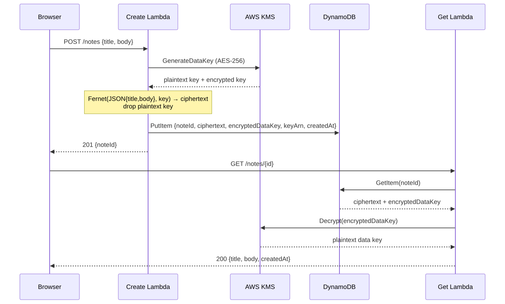

# Secure Notes App

A personal notes app where **every note is encrypted with its own AES-256 data key**, minted by AWS KMS. DynamoDB stores ciphertext only — a database leak reveals nothing without KMS access.

Static single-page frontend on S3 (optionally behind CloudFront + Origin Access Control) → HTTP API → four Python 3.12 Lambdas → DynamoDB, with a customer-managed KMS key and four least-privilege IAM roles.

**Features:** per-note envelope encryption · optional **tags** (plaintext metadata for search) with server-side `?q=` / `?tag=` filtering · optional **per-note expiry** via DynamoDB TTL · **note deletion** via `DELETE /notes/{id}` (its role gets `dynamodb:DeleteItem` only — destroying ciphertext needs no decryption, so zero KMS permissions) · **notes export** script · dark single-page frontend with search + tag chips.

## Architecture



## Data flow (envelope encryption)



### Why envelope encryption?

- KMS `Encrypt` caps plaintext at 4 KiB — envelope encryption handles notes of any size with one KMS call per note.
- Compromise of one data key exposes exactly one note, never the corpus.
- Rotating the KMS key only re-wraps data keys; existing ciphertext is untouched.
- See `src/common/crypto.py` for the implementation and a note on **data-key caching** (10-min TTL, AWS Encryption SDK style) as an interview talking point — deliberately *not* used here, because a personal notes app should default to one fresh key per note.

## Security model

| Component | Can do | Cannot do |
|---|---|---|
| Create Lambda role | `kms:GenerateDataKey` on the notes key; `dynamodb:PutItem` on the table | Decrypt anything, read the table, touch other keys |
| Get Lambda role | `kms:Decrypt` on the notes key; `dynamodb:GetItem` on the table | Mint data keys, write to the table |
| List Lambda role | `dynamodb:Scan` on the table — metadata only | Any KMS operation: cannot mint or unwrap data keys, so note contents stay sealed even if compromised |
| Delete Lambda role | `dynamodb:DeleteItem` on the table | Any KMS operation: deleting stored ciphertext never requires decryption, so there is nothing to leak even under compromise |
| KMS key policy | Mirrors the above (both key policy *and* identity policy must allow) | No `kms:*` for any Lambda role; root retains admin |
| DynamoDB | Holds ciphertext + wrapped keys + metadata (tags are plaintext by design, for search) | Never sees plaintext titles/bodies |
| DynamoDB TTL | Auto-deletes items whose numeric `expiresAt` has passed | — |
| CloudWatch Logs | noteId + byte counts | Plaintext bodies are never logged |
| S3 website bucket | Serves static assets | No secrets; `API_BASE` in `app.js` is just the public API URL |

### Design note: why tags are plaintext

`GET /notes` filters server-side without decrypting a single note — possible only because tags live outside the encrypted payload (DynamoDB String Set, like `createdAt`). The tradeoff is explicit: tags are searchable metadata, so never put secrets in them. Titles and bodies remain inside the envelope-encrypted payload, which is why full-text search is intentionally *not* offered — searching titles would require decrypting every note on the server.

## API

| Method | Path | Description |
|---|---|---|
| `POST` | `/notes` | Create a note. Body: `{"title", "body", "tags"? , "expiresAt"?}` → `201 {"noteId"}`. `tags`: ≤10 labels (lowercased, deduped). `expiresAt`: ISO-8601 or epoch seconds, must be in the future → DynamoDB TTL auto-deletes the note. |
| `GET` | `/notes` | List note **metadata** (never decrypts). Query: `?q=` substring over tags, `?tag=` exact tag, `?limit=` 1–100, `?nextToken=` pagination. → `{"notes": [{noteId, createdAt, tags, expiresAt, ciphertextBytes}], "count", "nextToken"}` |
| `GET` | `/notes/{id}` | Fetch + decrypt one note → `{noteId, title, body, createdAt, tags, expiresAt}` |
| `DELETE` | `/notes/{id}` | Delete a note → `204` (empty). `404` if the id does not exist — no silent success on a typo'd id. No KMS involved: the role only has `dynamodb:DeleteItem`. |

Export all notes (decrypted via the API) to JSON:

```bash
python3 scripts/export_notes.py --api-base https://<ApiEndpoint> [--tag finance] [--out notes.json]
```

The output contains plaintext bodies — keep the file private.

## Deploy

Prerequisites: AWS CLI + SAM CLI, credentials configured.

```bash
sam build
sam deploy --guided   # answer prompts; note the ApiEndpoint output
```

Then point the frontend at your API and upload it:

```bash
# 1. paste the ApiEndpoint output into frontend/app.js (API_BASE constant)
# 2. upload the site (bucket name is in the WebsiteBucketName output)
aws s3 sync frontend/ s3://<WebsiteBucketName>/ --delete
```

To serve over HTTPS with a private bucket instead of the S3 website endpoint:

```bash
sam deploy --guided --parameter-overrides EnableCloudFront=true
```

Tear down: `sam delete`.

## Cost (free tier)

At personal-note scale this sits comfortably in the AWS Free Tier: Lambda 1M requests/mo, API Gateway 1M HTTP calls/mo, DynamoDB 25 GB on-demand, KMS 20k requests/mo, S3/CloudFront starter allowances. Expected bill: **$0**.

## Tests

```bash
python3 -m pytest tests/ -q
```

98 tests, all mocked (fake KMS + fake DynamoDB in `tests/conftest.py`) — no AWS credentials or network needed:

- `test_crypto.py` — encrypt/decrypt round-trips, per-note key uniqueness, tampered-ciphertext / wrong-key / forged-key failures, 100 KB body under DynamoDB limits.
- `test_handlers.py` — create→get flow, validation (400/413), 404s, decryption-failure 500s, assertions that plaintext bodies never reach logs or storage; tag validation/normalization, expiry validation (ISO + epoch, future-only), tags/expiry round-trip through create→get.
- `test_delete.py` — `DELETE /notes/{id}` semantics: 204 on delete, 404 on missing or double delete, 400 on missing id, deleted note vanishes from get + list, and proof the delete path never calls KMS.
- `test_list.py` — list returns metadata only (no ciphertext, no titles/bodies), tag=`?tag=` exact and `?q=` substring filtering, combined filters, newest-first ordering, limit/nextToken pagination, bad-param 400s, and proof the list path never calls KMS.
- `test_export.py` — export script pagination, per-note fetch, tag/q filter passthrough, error mapping, JSON output shape.
- `test_template.py` — template parses; KMS key policy grants Lambdas only `GenerateDataKey`/`Decrypt`; no wildcard IAM actions; create role can't decrypt, get role can't mint, list role has Scan only and zero KMS; key policy avoids the role circular dependency (`!Sub` ARNs, not `!GetAtt`); TTL enabled on `expiresAt`; all three API routes present; no hardcoded credentials.

CI (`.github/workflows/ci.yml`) runs the suite and `sam validate --lint` on every push to main and every PR.

## Project layout

```
template.yaml            # SAM: API, Lambdas, KMS, DynamoDB (+TTL), S3 site (+ optional CloudFront/OAC)
src/
  requirements.txt       # cryptography, bundled by `sam build`
  common/crypto.py       # envelope-encryption helpers (+ data-key caching note)
  create_note/app.py     # POST /notes (tags + optional TTL expiry)
  get_note/app.py        # GET /notes/{id}
  delete_note/app.py     # DELETE /notes/{id} — no KMS needed (ciphertext destroy)
  list_notes/app.py      # GET /notes — metadata-only search, never decrypts (no KMS perms)
scripts/
  export_notes.py        # export all notes (decrypted via API) to timestamped JSON
frontend/
  index.html styles.css app.js   # dark single-page UI: compose + open + browse/search; set API_BASE after deploy
tests/
  conftest.py test_crypto.py test_handlers.py test_list.py test_export.py test_template.py
.github/workflows/ci.yml # pytest + `sam validate --lint` on push/PR
```

## Enhancement ideas

- Cognito user pools + per-user KMS grants (multi-tenant instead of personal).
- Data-key caching with 10-min TTL for high-throughput workloads.
- S3 versioning for note history.
- WAF on the HTTP API + tightened CORS origin (currently `*` for demo simplicity).

## Portfolio deliverables checklist

- [ ] Screenshot: CloudFront/S3 URL serving the site
- [ ] Screenshot: API Gateway routes (`POST /notes`, `GET /notes/{id}`)
- [ ] Screenshot: DynamoDB item showing ciphertext + `encryptedDataKey` (no plaintext)
- [ ] Screenshot: create → get flow with CloudWatch logs (noteId only, no content)
- [ ] Short demo GIF: seal a note → open it with its ID
- [ ] GitHub repo with code + this README (architecture, encryption design, least-privilege policies, tests, costs)
- [ ] LinkedIn post one-liner + repo link
- [ ] Resume bullet: *"Built an envelope-encrypted notes app (KMS per-note data keys, Lambda, API Gateway, DynamoDB); zero plaintext at rest or in logs."*

## Terms & Disclaimer

By using this project you agree to the following.

- **No warranty.** This software is provided "as is", without warranty of any kind, express or implied, including merchantability, fitness for a particular purpose, and non-infringement.
- **No liability.** To the maximum extent permitted by law, the author and contributors are not liable for any claim, loss, or damage (direct, indirect, incidental, or consequential, including lost data or profits) arising from its use.
- **Your responsibility.** You use it at your own risk and are responsible for complying with the laws that apply to you.
- **Your data.** Keep backups; data loss is possible. If you process other people's personal information, you are responsible for complying with privacy laws such as US state privacy laws (e.g. CCPA), PIPEDA and Quebec's Law 25 (Canada), and the Digital Personal Data Protection Act, 2023 (India).
- **Cloud costs and security.** If you deploy this, you are responsible for its security configuration and for any charges from your cloud provider.
- **Third parties.** Names, logos, APIs, and services of others belong to their owners and are used for identification only; no affiliation or endorsement is implied.
- **Your statutory rights.** Nothing here limits rights that cannot be waived by agreement, including under consumer-protection laws in the USA, Canada (including Quebec), and India (Consumer Protection Act, 2019).
- **License.** No open-source license is granted. All rights reserved; you may view and fork this repository only as GitHub's Terms of Service allow.

## Content, Assets & Fair Use

- **Original work.** Unless noted otherwise (including below), the code, text, design, and images in this repository were created by the author.
- **Libraries, fonts, and icons.** Third-party libraries, fonts (for example Google Fonts), and icon sets belong to their creators and are used under their own licenses; see the dependency manifests and each source for terms.
- **Logos, brands, and screenshots.** Third-party names, logos, and screenshots appear only to identify or describe their products (nominative use). They remain the property of their owners and do not imply affiliation or endorsement.
- **Ideas and inspiration.** Where this project is inspired by another product, game, or idea, it is an independent implementation. It borrows only general ideas, mechanics, or styles, which are not anyone's exclusive property, and is meant to contain no third-party code or artwork used without permission.
- **Fair use and fair dealing.** Any third-party material is used in limited ways for purposes such as education, research, review, commentary, or identification, relying on fair use in the USA (17 U.S.C. § 107), fair dealing in Canada (Copyright Act, ss. 29–29.2), and fair dealing in India (Copyright Act, 1957, s. 52), where they apply.
- **Concerns and takedown requests.** If you own rights in something here and believe it is used improperly, [open an issue](https://github.com/Sanjays2402/secure-notes-app/issues) or contact the author through their GitHub profile with a link to the material and your claim. It will be reviewed promptly and credited, changed, or removed as appropriate. You may also use GitHub's DMCA process.
- **Contributions.** By contributing, you confirm you have the right to submit your contribution and agree it is licensed under this repository's license.
